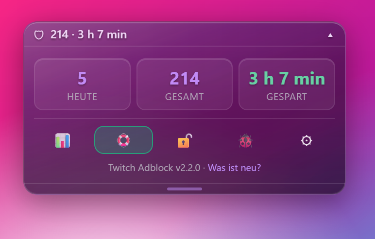

# Quickguide – Twitch Adblock

[🇬🇧 English](QUICKSTART.md) | 🇩🇪 **Deutsch** · Ausführlich: [README.de.md](README.de.md)

## In 3 Schritten installiert

Geführt mit Buttons: **[Installations-Seite](https://r79jv66tjh-byte.github.io/twitch-adblock/)** – oder von Hand:

1. **Tampermonkey** (oder Violentmonkey) aus dem Store deines Browsers installieren.
   Chrome/Edge: Rechtsklick aufs Tampermonkey-Symbol → *Erweiterung verwalten* → **„Userscripts zulassen“** einschalten.
2. **[Script installieren](https://raw.githubusercontent.com/r79jv66tjh-byte/twitch-adblock/main/twitch-adblock.user.js)** → *Installieren*.
3. Twitch mit **Strg + F5** neu laden und einen Kanal öffnen – unten links erscheint **🛡**.

Updates kommen automatisch. Gibt es eine neue Version, zeigt die Box **⬆**.

## Die Box auf einen Blick

| | |
|---|---|
| **🛡 42 · 1 h 13 min** | 42 Werbepausen blockiert, 1 h 13 min gespart |
| **⏳ Werbung · Ersatz 720p** | Gerade läuft Werbung – du siehst stattdessen einen werbefreien Stream |
| **✓ 45 s gespart** | Werbepause vorbei |
| **▾** / Doppelklick / **Alt + A** | Panel auf- und zuklappen |
| **Esc** / Klick daneben | Panel schließen |
| **Kopfzeile ziehen** | Box verschieben (rastet am Rand ein) · Doppelklick auf 🛡 = zurück nach unten links |

**Icon-Leiste** (Maus drüber = Beschriftung):

| 📊 | 🛟 | 🔒 | 🐞 | ⚙ |
|---|---|---|---|---|
| Statistik | Notfall-Modus | Box sperren | Hilfe & Fehler melden | Einstellungen |

Kacheln antippen: **heute ↔ 7 Tage**, **gespart gesamt ↔ heute**.

## Wenn doch Werbung durchrutscht

- Der **🛟 Notfall-Modus** schaltet sie automatisch **stumm und unscharf**.
- Sie wird automatisch protokolliert; von Hand: **Alt + W**.
- Passiert das öfter: **🐞 → 🐞 Fehler melden** – das Protokoll wird kopiert und das GitHub-Formular öffnet sich. Mit **Strg + V** ins Feld „Protokoll“ einfügen.

## Gut zu wissen

- Twitch baut Werbung direkt in den Stream ein – **kein Blocker schafft 100 %**. Ändert Twitch etwas, kann der Blocker zeitweise ausfallen.
- Alle Daten bleiben **nur in deinem Browser**.
- **Dev-Modus** zur Fehlersuche: **5× schnell auf 🐞** → Reiter **🛠** (Selbsttest, Protokolle).
- Aussehen: ⚙ → Anzeige → **Glas-Design**, **Akzentfarbe**, **Mini-Modus**.
