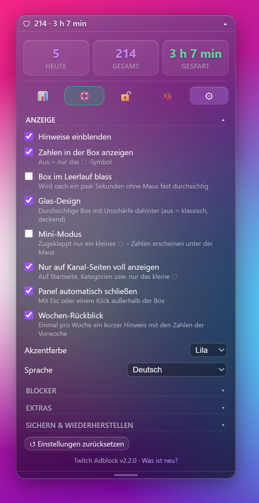
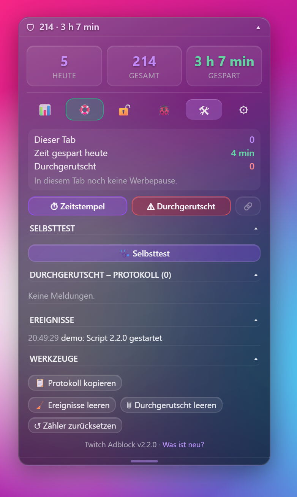

# Twitch Adblock – Userscript

[🇬🇧 English](README.md) | 🇩🇪 **Deutsch**

*Dieses Projekt ist KI-gestützt entwickelt (vibecoded).*

Blockiert bzw. umgeht auf twitch.tv:

- **Werbung im Stream** (Pre-Rolls und Mid-Rolls)
- **Werbebanner und Overlays** auf der Seite (Display-Ads, „Werbung“-Label, Countdown, Amazon-Ad-Iframes)

Dazu: Werbe-Zähler mit gesparter Zeit, Notfall-Modus, Bild-Reparatur, Verlauf, Fehlerprotokoll – auf Deutsch und Englisch.

## Wichtig vorab – ehrliche Einschätzung

Twitch schneidet die Werbung **serverseitig direkt in den Videostream** ein („Stitched Ads“). Es gibt also keine separate Werbe-Adresse, die man einfach sperren könnte, wie bei normalen Bannern. Das Script arbeitet deshalb so:

1. Es erkennt Werbesegmente in der Stream-Playlist.
2. Es fragt bei Twitch einen **zweiten Stream** mit einem anderen Player-Typ an (z. B. „embed“), der oft werbefrei ist, und spielt diesen während der Werbepause ab.
3. Klappt das nicht, **schneidet es die Werbesegmente heraus**. Dann bleibt das Bild ggf. für die Dauer der Werbung stehen oder wird schwarz – aber du siehst/hörst keine Werbung.

**Kein Blocker garantiert, dass alle Werbung verschwindet.** Twitch ändert sein System regelmäßig; dann kann das Script von heute auf morgen teilweise oder gar nicht mehr funktionieren. Während einer Werbepause kann die Qualität kurz sinken oder der Stream kurz ruckeln.

Rechtlicher Hinweis: Das Blockieren von Werbung kann gegen die Nutzungsbedingungen von Twitch verstoßen. Die Nutzung erfolgt auf eigene Verantwortung. Wer Streamer unterstützen möchte, kann das über Abos oder Twitch Turbo tun.

## Installation (Chrome, Edge, Firefox)

**Am einfachsten: die [Installations-Seite](https://r79jv66tjh-byte.github.io/twitch-adblock/)** – erkennt deinen Browser und führt dich mit je einem Button durch die 3 Schritte.

### 1. Userscript-Manager installieren

Installiere **eine** dieser Erweiterungen aus dem offiziellen Store deines Browsers:

- **Tampermonkey** (Chrome, Edge, Firefox)
- **Violentmonkey** (Chrome, Edge, Firefox)

### 2. Nur bei Chrome/Edge: Userscripts erlauben

- Rechtsklick auf das Tampermonkey-Symbol → **Erweiterung verwalten**
- Den Schalter **„Nutzerscripts zulassen“** (bzw. „Allow User Scripts“) einschalten
- Falls es diesen Schalter nicht gibt: unter `chrome://extensions` bzw. `edge://extensions` oben rechts den **Entwicklermodus** aktivieren.

### 3. Script hinzufügen

**Empfohlen – direkt von GitHub (mit automatischen Updates):**
Klicke auf **[twitch-adblock.user.js installieren](https://raw.githubusercontent.com/r79jv66tjh-byte/twitch-adblock/main/twitch-adblock.user.js)** → Tampermonkey/Violentmonkey öffnet die Installationsseite → **Installieren**.

Alternativ: Die Datei `twitch-adblock.user.js` in ein Browserfenster ziehen, oder in Tampermonkey **Neues Script erstellen**, den Inhalt einfügen und mit **Strg + S** speichern.

### 4. Testen

1. Twitch-Tab **neu laden** (am besten Strg + F5).
2. Einen Kanal öffnen. Unten links erscheint die Box „🛡 0“.
3. Kommt Werbung, leuchtet die Kopfzeile der Box und zeigt z. B. „⏳ Werbung · Ersatz 720p“, danach kurz „✓ 45 s gespart“.

Kurzfassung: **[Quickguide](QUICKSTART.de.md)**.

## Die Box

Unten links zeigt die Box z. B. **„🛡 42 · 1 h 13 min“** = 42 Werbepausen blockiert, 1 h 13 min gespart (gesparte Zeit = Summe der Werbespot-Längen, die Twitch in den Stream schreibt).

<p>
  <br>
  
  
</p>

Standardmäßig im **Glas-Design** (durchsichtig mit Unschärfe dahinter) – abschaltbar unter ⚙ Einstellungen → Anzeige → Glas-Design. Dort lässt sich auch die Akzentfarbe wählen (Lila, Blau, Grün, Pink).

**Kopfzeile**

| Element | Funktion |
|---|---|
| **Kopfzeile ziehen** | Box verschieben – nah am Rand rastet sie ein (Position wird gespeichert) |
| **Doppelklick auf 🛡** | Box zurück an die Standardposition (unten links) |
| **▾ / ▴** | Panel auf- und zuklappen (auch Doppelklick auf die Kopfzeile oder **Alt + A**) |
| **⬆** | Erscheint, wenn ein Update verfügbar ist – Klick öffnet die Installation |

**Während einer Werbepause** leuchtet die Kopfzeile und zeigt z. B. **„⏳ Werbung · Ersatz 720p“**, danach kurz **„✓ 45 s gespart“**. Ein Hinweis-Fenster erscheint nur noch, wenn die Werbung herausgeschnitten werden muss (Bild kann kurz stehen bleiben) – und im **Vollbild**, wo die Box nicht sichtbar ist (oben mittig im Player).

### Panel

- **Drei Kacheln:** heute · gesamt · gespart. Klick auf **heute** wechselt zu den letzten 7 Tagen, Klick auf **gespart** zwischen gesamt und heute.
- Ist Werbung durchgerutscht, erscheint eine rote Zeile „⚠ 2 durchgerutscht“.
- **Icon-Leiste** – mit der Maus über ein Icon fahren zeigt, was es ist:

| Icon | Funktion |
|---|---|
| **📊** | Statistik: Balken der letzten 7 Tage und die Kanäle mit der meisten Werbung |
| **🛟** | Notfall-Modus an (grün) / aus (grau) |
| **🔓 / 🔒** | Box verschiebbar / gesperrt |
| **🐞** | Hilfe: 🐞 Fehler melden, 🔄 Nach Updates suchen |
| **🛠** | Dev-Werkzeuge (nur im Dev-Modus, siehe unten) |
| **⚙** | Einstellungen |

- Es ist immer nur ein Bereich offen; erneuter Klick aufs Icon schließt ihn.
- Das Panel schließt sich mit **Esc** oder einem **Klick außerhalb der Box** (abschaltbar).
- Fußzeile: **Version** und Link „Was ist neu?“
- **Höhe:** Aufgeklappt ist das Panel höchstens **halb so hoch wie das Fenster** und scrollt. Mit dem **Griff** (kleiner Strich am Rand) lässt sich die Höhe frei ziehen; Doppelklick auf den Griff = wieder halbe Höhe.

**🛟 Notfall-Modus:** Rutscht trotzdem Werbung durch (Twitch zeigt sein „Werbung“-Label oder den Countdown), wird der Stream **stummgeschaltet und stark unscharf**, bis die Werbung vorbei ist. Danach ist alles wieder wie vorher.

**Durchgerutschte Werbung** wird automatisch protokolliert; von Hand mit **Alt + W**.

### 🛠 Dev-Modus (versteckt)

Für die Fehlersuche. Ein-/ausschalten: **5× schnell auf 🐞** klicken. Dann erscheint in der Icon-Leiste der Reiter **🛠** (ein gelber Punkt = es gibt ein aktuelles Problem):



- **Status:** „Dieser Tab“, Zeit gespart heute, Durchgerutscht, letzte Werbepause mit Methode, **letztes Problem** (gelb = Warnung, rot = Fehler)
- **⏱ Zeitstempel** (kopiert Uhrzeit, Kanal, Methode – speichert nichts, **Alt + Z**), **⚠ Durchgerutscht** und **🔗 Sync** (koppelt Zeitstempel und Durchgerutscht)
- **🩺 Selbsttest:** prüft live mit ✓/✗, ob ein Kanal geöffnet ist, das Video läuft, der Video-Worker verbunden ist, die Stream-Liste erkannt wird (inkl. Adressform), Twitch einen Ersatz-Stream liefert (Qualität, gerade werbefrei?, dazu alle Player-Typen einzeln, z. B. „embed 1080p ✗ · popout 360p ✓“) und GitHub erreichbar ist. Das Ergebnis steht auch im Protokoll – ideal, um zu prüfen, ob Twitch etwas geändert hat, ohne auf Werbung warten zu müssen.
- **Durchgerutscht-Protokoll** und **Ereignisliste** (die letzten 15 Einträge)
- **Werkzeuge:** **📋 Protokoll kopieren**; **🧹 Ereignisse leeren** (nur das Ereignis-Protokoll), **🗑 Durchgerutscht leeren** (Liste und Zähler „Durchgerutscht“), **↺ Zähler zurücksetzen** (alle Zähler und der Verlauf) – Löschen fragt jeweils nach: 1. Klick „Sicher? Nochmal klicken“, 2. Klick innerhalb von 4 s

Das Protokoll schreibt **immer** im Hintergrund mit – auch bei ausgeschaltetem Dev-Modus.

### ⚙ Einstellungen

Alles wird sofort gespeichert.

| Einstellung | Wirkung | Standard |
|---|---|---|
| **Anzeige** | | |
| Hinweise einblenden | Lila Hinweise an/aus | an |
| Zahlen in der Box anzeigen | Aus = nur das 🛡-Symbol | an |
| Box im Leerlauf blass | Box wird nach 4 s ohne Maus fast durchsichtig (zugeklappt) | an |
| Glas-Design | Durchsichtige Box mit Unschärfe dahinter; aus = klassisch, deckend | an |
| Mini-Modus | Zugeklappt nur ein kleines 🛡 – Zahlen erscheinen unter der Maus | aus |
| Nur auf Kanal-Seiten voll anzeigen | Auf Startseite, Kategorien usw. nur das kleine 🛡 | an |
| Panel automatisch schließen | Mit Esc oder einem Klick außerhalb der Box | an |
| Wochen-Rückblick | Einmal pro Woche ein kurzer Hinweis mit den Zahlen der Vorwoche | an |
| Akzentfarbe | Lila, Blau, Grün, Pink | Lila |
| Sprache | Automatisch (Browser), Deutsch, English | automatisch |
| **Blocker** | | |
| Notfall-Modus | Durchgerutschte Werbung stumm & unscharf | an |
| Durchgerutschte Werbung automatisch protokollieren | Protokolliert Werbung, die Twitch anzeigt | an |
| Hängendes Bild automatisch reparieren | Hängt das Bild > 10 s: zum Live-Bild springen → Player neu starten → Seite neu laden (max. alle 5 min) | an |
| Ersatz-Stream nur in voller Qualität | Ist der Ersatz-Stream schlechter als dein Stream, wird die Werbung lieber herausgeschnitten; wirkt nach Neuladen | aus |
| Werbung in Aufzeichnungen (VODs) filtern | Experimentell, wirkt nach Neuladen | aus |
| **Extras** | | |
| Tastenkürzel | Alt + A = Panel auf/zu, Alt + W = Durchgerutscht, Alt + Z = Zeitstempel (nicht beim Tippen im Chat) | an |
| Täglich nach Updates suchen | Prüft einmal am Tag auf GitHub, zeigt ⬆ bei neuer Version | an |
| Turbo-Werbung ausblenden | Blendet Turbo-Hinweise aus | aus |
| Prime-Gaming-Banner ausblenden | Blendet Prime-Gaming-Hinweise aus | aus |
| Video auf der Startseite stoppen | Stoppt das automatisch startende Video auf twitch.tv | aus |
| **💾 Sichern / 📂 Wiederherstellen** | Zähler, Verlauf, Einstellungen und Protokoll als Datei, z. B. für einen neuen PC | |
| **📄 CSV-Export** | Verlauf pro Tag und Kanäle als CSV-Datei, z. B. für Excel | |
| **↺ Einstellungen zurücksetzen** | Alle Einstellungen auf Standard – Zähler, Verlauf und Protokoll bleiben | |

Alles bleibt **nur lokal in deinem Browser** (Speicher von twitch.tv). Es wird nichts an Twitch oder irgendeinen Server geschickt – außer der täglichen Update-Abfrage bei GitHub (lädt nur die Script-Datei, sendet keine Daten).

## Updates

- Über den GitHub-Link installiert, holt sich Tampermonkey neue Versionen selbst (etwa einmal am Tag).
- Zusätzlich zeigt die Box **⬆**, sobald es eine neue Version gibt. Klick darauf → in Tampermonkey **Aktualisieren**.
- Sofort: im Panel **🐞 → 🔄 Nach Updates suchen** oder Tampermonkey-Symbol → **Nach Userscript-Updates suchen**.
- Nach einem Update erscheint kurz, was neu ist. Alle Änderungen: [CHANGELOG.md](CHANGELOG.md).

## Fehler melden – so geht's am besten

1. **Neueste Version?** Im Panel **🐞 → 🔄 Nach Updates suchen** klicken – viele Probleme sind schon behoben.
2. **Liegt es am Script?** Script im Tampermonkey-Menü kurz ausschalten, Seite mit Strg + F5 neu laden. Ist das Problem dann weg, liegt es am Script – sonst eher an Twitch (z. B. Kanal wirklich offline).
3. **Problem nachstellen:** Script wieder einschalten, Kanal öffnen und warten, bis das Problem auftritt. Bei durchgerutschter Werbung: sofort **Alt + W** drücken – dann steht der genaue Zeitpunkt im Protokoll.
4. **Melden:** Box aufklappen → **🐞** → **🐞 Fehler melden**. Das Protokoll wird in die Zwischenablage kopiert und das Formular auf GitHub geöffnet (dafür brauchst du ein kostenloses GitHub-Konto).
5. **Formular ausfüllen:** Was ist passiert, Kanal, kurze Beschreibung – und im Feld **„Protokoll“** mit **Strg + V** einfügen. Absenden.

**Was steht im Protokoll?** Script-Version, Browser-Version, aktuelle Seite (Kanalname), Einstellungen, die letzten 100 Ereignisse (z. B. „Stream geladen“, „Werbepause blockiert“, Fehler) und das Durchgerutscht-Protokoll. **Keine** Passwörter, Anmeldedaten oder Chat-Inhalte. Achtung: GitHub-Issues sind öffentlich – schau vor dem Absenden kurz drüber.

Ohne GitHub-Konto: Dev-Modus (5× 🐞) → **🛠 → 📋 Protokoll kopieren** und das Protokoll auf anderem Weg weitergeben.

## Protokoll zur Fehlersuche

Das Script schreibt automatisch mit, was passiert – die Browser-Konsole (F12) brauchst du nicht:

- **Stream-Status:** was Twitch beim Laden antwortet, z. B. „Stream geladen: xyz (6 Qualitäten)“ oder **„Twitch meldet xyz als OFFLINE (HTTP 404)“** / „Twitch verweigert den Stream (HTTP 403)“
- **Video-Worker:** ob sich das Script in den Twitch-Player einklinken konnte (wenn nicht, wird Stream-Werbung nicht gefiltert)
- **Werbepausen:** blockierte Pausen mit Methode und gesparter Zeit, Probleme mit dem Ersatz-Stream
- **Bild-Reparatur:** wann das Bild hing und welche Reparatur gegriffen hat
- **Fehler:** Script-Fehler, Video-Fehler und Fehlermeldungen des Players (z. B. „Fehler #2000“)

Gespeichert werden bis zu 200 Ereignisse, ältere fallen automatisch weg.

**Tipp:** Vor einer Fehlermeldung im Dev-Modus (5× 🐞 → 🛠) kurz **🩺 Selbsttest** ausführen – das Ergebnis landet im Protokoll und hilft bei der Fehlersuche.

**Stream wird als offline angezeigt?** Steht im Protokoll „OFFLINE (HTTP 404)“, meldet Twitch selbst den Kanal als offline – das liegt nicht am Script. Eigene Fehler kennzeichnet das Script mit „Fehler im Script, Stream lädt ohne Filter weiter“; der Stream lädt dann normal, nur ohne Werbefilter.

## Tipps

- **Zusätzlich uBlock Origin** (bzw. „uBlock Origin Lite“ in Chrome) schadet nicht – das fängt weitere Tracker und Banner ab.
- Funktioniert die Stream-Werbung nicht mehr, hat Twitch vermutlich etwas geändert – bitte melden (siehe oben). Gut gepflegte Alternativen sind z. B. die Projekte „TwitchAdSolutions“ (vaft) auf GitHub.

## Dateien

| Datei | Inhalt |
|---|---|
| `twitch-adblock.user.js` | Das Userscript |
| `README.md` / `README.de.md` | Anleitung Englisch / Deutsch |
| `QUICKSTART.md` / `QUICKSTART.de.md` | Quickguide Englisch / Deutsch |
| `CHANGELOG.md` | Alle Änderungen pro Version |
| `.github/ISSUE_TEMPLATE/` | Formulare für Fehlermeldungen und Ideen |
| `tests/worker.test.mjs` | Automatische Tests (Werbung, Ersatz-Stream, Offline, VOD, Selbsttest) – lokal: `node --test tests/worker.test.mjs` |
| `docs/index.html` | Installations-Seite (GitHub Pages) |
| `docs/screenshots/` | Bilder für diese Anleitung |
| `.github/workflows/check.yml` | Automatische Prüfung bei jedem Push (Syntax, Tests, Versionsnummern) |
| `LICENSE` | MIT-Lizenz |

## Lizenz

[MIT](LICENSE) – frei nutzbar, veränderbar und weitergebbar, solange der Lizenzhinweis erhalten bleibt. Ohne jede Gewähr.

## Neue Version veröffentlichen (für den Repo-Besitzer)

1. Änderungen in `twitch-adblock.user.js` machen.
2. **`@version`** oben im Script und die Konstante **`VERSION`** erhöhen (z. B. `2.0.0` → `2.0.1`), dazu `WHATS_NEW` anpassen.
3. Eintrag in **`CHANGELOG.md`** ergänzen (die automatische Prüfung schlägt sonst fehl).
4. Committen, pushen und Release erstellen:
   ```bash
   git add -A
   git commit -m "Version 2.0.1: kurze Beschreibung"
   git push
   gh release create v2.0.1 --title "2.0.1" --notes "kurze Beschreibung"
   ```
