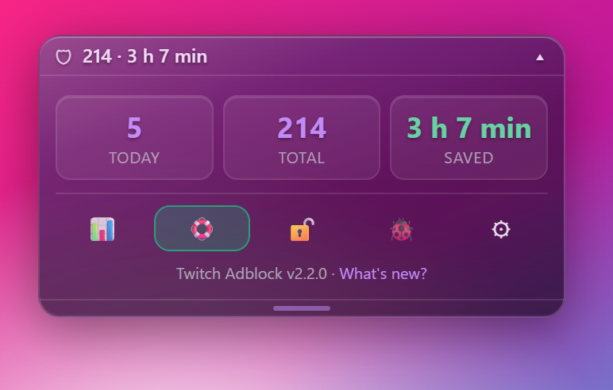
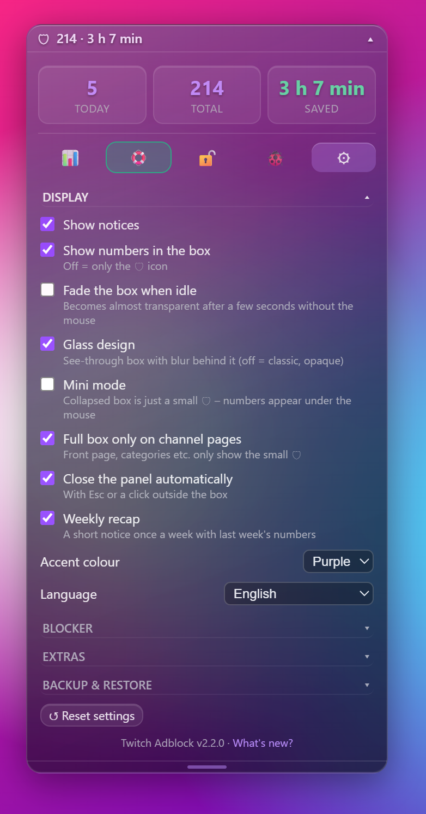
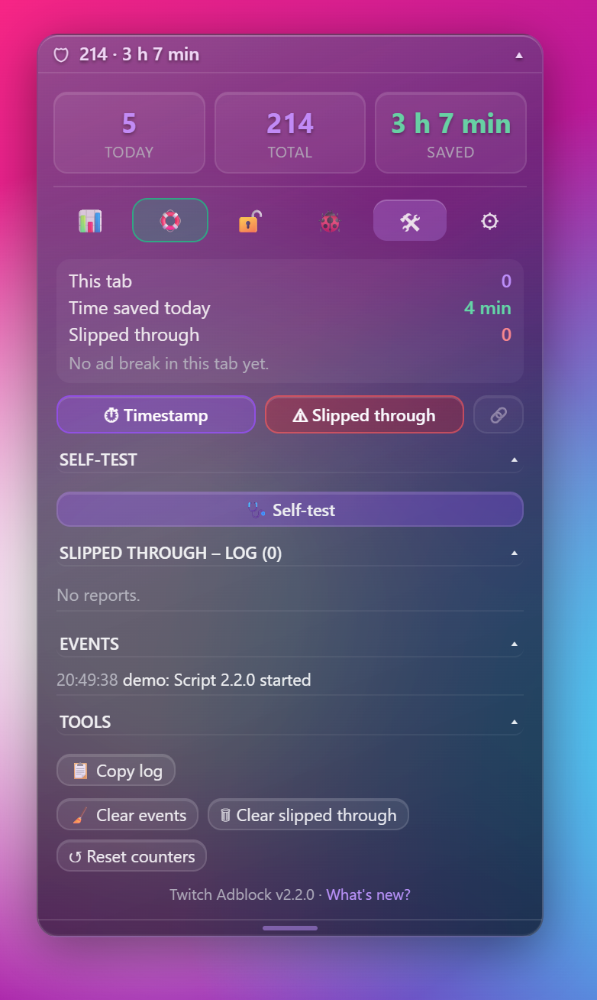

# Twitch Adblock – Userscript

🇬🇧 **English** | [🇩🇪 Deutsch](README.de.md)

*This project is AI-assisted (vibecoded).*

Blocks or bypasses on twitch.tv:

- **Ads in the stream** (pre-rolls and mid-rolls)
- **Ad banners and overlays** on the page (display ads, "Ad" label, countdown, Amazon ad iframes)

Plus: ad counter with time saved, emergency mode, picture repair, history, troubleshooting log – in English and German.

## Important – an honest assessment

Twitch inserts ads **server-side directly into the video stream** ("stitched ads"). There is no separate ad address that could simply be blocked like a regular banner. The script therefore works like this:

1. It detects ad segments in the stream playlist.
2. It requests a **second stream** from Twitch with a different player type (e.g. "embed"), which is often ad-free, and plays it during the ad break.
3. If that fails, it **cuts the ad segments out**. The picture may then freeze or go black for the length of the ad – but you won't see or hear the ad.

**No blocker can guarantee that all ads disappear.** Twitch changes its system regularly; the script may then stop working partially or completely overnight. During an ad break the quality may drop briefly or the stream may stutter.

Legal notice: Blocking ads may violate Twitch's Terms of Service. Use at your own risk. If you want to support streamers, consider subscriptions or Twitch Turbo.

## Installation (Chrome, Edge, Firefox)

**Easiest: the [install page](https://r79jv66tjh-byte.github.io/twitch-adblock/)** – detects your browser and guides you through the 3 steps with one button each.

### 1. Install a userscript manager

Install **one** of these extensions from your browser's official store:

- **Tampermonkey** (Chrome, Edge, Firefox)
- **Violentmonkey** (Chrome, Edge, Firefox)

### 2. Chrome/Edge only: allow userscripts

- Right-click the Tampermonkey icon → **Manage extension**
- Turn on **"Allow User Scripts"**
- If that switch doesn't exist: enable **Developer mode** in the top right of `chrome://extensions` or `edge://extensions`.

### 3. Add the script

**Recommended – directly from GitHub (with automatic updates):**
Click **[install twitch-adblock.user.js](https://raw.githubusercontent.com/r79jv66tjh-byte/twitch-adblock/main/twitch-adblock.user.js)** → Tampermonkey/Violentmonkey opens the install page → **Install**.

Alternatively: drag the file `twitch-adblock.user.js` into a browser window, or in Tampermonkey **Create a new script**, paste the contents and save with **Ctrl + S**.

### 4. Test

1. **Reload** the Twitch tab (preferably Ctrl + F5).
2. Open a channel. The box "🛡 0" appears in the bottom left.
3. During an ad break the box's top row glows and shows e.g. "⏳ Ad · replacement 720p", afterwards briefly "✓ 45 s saved".

Short version: **[Quick guide](QUICKSTART.md)**.

## The box

In the bottom left the box shows e.g. **"🛡 42 · 1 h 13 min"** = 42 ad breaks blocked, 1 h 13 min saved (time saved = sum of the ad spot lengths Twitch writes into the stream).

<p>
  <br>
  
  
</p>

**Glass design** by default (see-through with blur behind it) – can be turned off under ⚙ Settings → Display → Glass design. The accent colour (purple, blue, green, pink) can be chosen there too.

**Top row**

| Element | Function |
|---|---|
| **Drag the top row** | Move the box – near an edge it snaps into place (position is saved) |
| **Double-click 🛡** | Box back to its default position (bottom left) |
| **▾ / ▴** | Expand/collapse the panel (also double-click the top row or **Alt + A**) |
| **⬆** | Appears when an update is available – click to install |

**During an ad break** the top row glows and shows e.g. **"⏳ Ad · replacement 720p"**, afterwards briefly **"✓ 45 s saved"**. A pop-up notice only appears if the ad has to be cut out (the picture may freeze briefly) – and in **fullscreen**, where the box isn't visible (top centre of the player).

### Panel

- **Three tiles:** today · total · saved. Click **today** to switch to the last 7 days, click **saved** to switch between total and today.
- If an ad slipped through, a red line "⚠ 2 slipped through" appears.
- **Icon bar** – hover over an icon to see what it does:

| Icon | Function |
|---|---|
| **📊** | Statistics: bar chart of the last 7 days and the channels with the most ads |
| **🛟** | Emergency mode on (green) / off (grey) |
| **🔓 / 🔒** | Box movable / locked |
| **🐞** | Help: 🐞 Report a problem, 🔄 Check for updates |
| **🛠** | Dev tools (only in dev mode, see below) |
| **⚙** | Settings |

- Only one area is open at a time; clicking the icon again closes it.
- The panel closes with **Esc** or a **click outside the box** (can be turned off).
- Footer: **version** and a "What's new?" link.
- **Height:** when expanded, the panel takes at most **half the window height** and scrolls. Drag the **grip** (small bar at the edge) to change the height freely; double-click the grip = back to half.

**🛟 Emergency mode:** if an ad still slips through (Twitch shows its "Ad" label or countdown), the stream is **muted and heavily blurred** until the ad is over. Afterwards everything returns to how it was.

**Ads that slip through** are logged automatically; manually with **Alt + W**.

### 🛠 Dev mode (hidden)

For troubleshooting. Turn on/off: click **🐞 five times quickly**. Then the **🛠** tab appears in the icon bar (a yellow dot = there is a current problem):



- **Status:** "this tab", time saved today, slipped through, last ad break with method, **last problem** (yellow = warning, red = error)
- **⏱ Timestamp** (copies time, channel, method – saves nothing, **Alt + Z**), **⚠ Slipped through** and **🔗 Sync** (links timestamp and slipped through)
- **🩺 Self-test:** checks live with ✓/✗ whether a channel is open, the video plays, the video worker is connected, the stream list is recognised (incl. address form), Twitch provides a replacement stream (quality, currently ad-free?, plus every player type separately, e.g. "embed 1080p ✗ · popout 360p ✓") and GitHub is reachable. The result is also logged – ideal to check whether Twitch changed something without waiting for an ad.
- **Slipped-through log** and **event list** (last 15 entries)
- **Tools:** **📋 Copy log**; **🧹 Clear events** (only the event log), **🗑 Clear slipped through** (list and "slipped through" counter), **↺ Reset counters** (all counters and history) – each asks for confirmation: 1st click "Sure? Click again", 2nd click within 4 s

The log is **always** recorded in the background – even with dev mode off.

### ⚙ Settings

Everything is saved immediately.

| Setting | Effect | Default |
|---|---|---|
| **Display** | | |
| Show notices | Purple notices on/off | on |
| Show numbers in the box | Off = only the 🛡 icon | on |
| Fade the box when idle | Box becomes almost transparent after 4 s without the mouse (collapsed) | on |
| Glass design | See-through box with blur behind it; off = classic, opaque | on |
| Mini mode | Collapsed box is just a small 🛡 – numbers appear under the mouse | off |
| Full box only on channel pages | Front page, categories etc. only show the small 🛡 | on |
| Close the panel automatically | With Esc or a click outside the box | on |
| Weekly recap | A short notice once a week with last week's numbers | on |
| Accent colour | Purple, blue, green, pink | purple |
| Language | Automatic (browser), Deutsch, English | automatic |
| **Blocker** | | |
| Emergency mode | Mute & blur ads that slip through | on |
| Log ads that slip through automatically | Logs ads that Twitch shows | on |
| Repair frozen picture automatically | Picture frozen > 10 s: jump to live picture → restart player → reload page (max. every 5 min) | on |
| Replacement stream only in full quality | If the replacement stream is worse than your stream, the ad is cut out instead; takes effect after reload | off |
| Filter ads in recordings (VODs) | Experimental, takes effect after reload | off |
| **Extras** | | |
| Keyboard shortcuts | Alt + A = open/close panel, Alt + W = slipped through, Alt + Z = timestamp (not while typing in chat) | on |
| Check for updates daily | Checks GitHub once a day, shows ⬆ for a new version | on |
| Hide Turbo ads | Hides Turbo prompts | off |
| Hide Prime Gaming banners | Hides Prime Gaming prompts | off |
| Stop the video on the front page | Stops the autoplaying video on twitch.tv | off |
| **💾 Back up / 📂 Restore** | Counters, history, settings and log as a file, e.g. for a new PC | |
| **📄 CSV export** | History per day and channels as a CSV file, e.g. for Excel | |
| **↺ Reset settings** | All settings back to default – counters, history and log are kept | |

Everything stays **only locally in your browser** (twitch.tv storage). Nothing is sent to Twitch or any server – except the daily update check on GitHub (only downloads the script file, sends no data).

## Updates

- Installed via the GitHub link, Tampermonkey fetches new versions on its own (about once a day).
- In addition, the box shows **⬆** as soon as a new version exists. Click it → **Update** in Tampermonkey.
- Right away: **🐞 → 🔄 Check for updates** in the panel, or Tampermonkey icon → **Check for userscript updates**.
- After an update, a short "what's new" notice appears. All changes: [CHANGELOG.md](CHANGELOG.md).

## Reporting problems – the best way

1. **Latest version?** Click **🐞 → 🔄 Check for updates** in the panel – many problems are already fixed.
2. **Is it the script?** Briefly disable the script in the Tampermonkey menu and reload with Ctrl + F5. If the problem is gone, it's the script – otherwise it's probably Twitch (e.g. the channel really is offline).
3. **Reproduce it:** enable the script again, open the channel and wait for the problem. For an ad that slipped through: press **Alt + W** right away – then the exact time is in the log.
4. **Report:** expand the box → **🐞** → **🐞 Report a problem**. The log is copied to the clipboard and the form on GitHub opens (you need a free GitHub account).
5. **Fill in the form:** what happened, channel, short description – and paste with **Ctrl + V** into the **"Log"** field. Submit.

**What's in the log?** Script version, browser version, current page (channel name), settings, the last 100 events (e.g. "Stream loaded", "Ad break blocked", errors) and the slipped-through log. **No** passwords, login data or chat contents. Note: GitHub issues are public – have a quick look before submitting.

Without a GitHub account: dev mode (5× 🐞) → **🛠 → 📋 Copy log** and share the log another way.

## Troubleshooting log

The script automatically records what happens – no browser console (F12) needed:

- **Stream status:** what Twitch answers when loading, e.g. "Stream loaded: xyz (6 qualities)" or **"Twitch reports xyz as OFFLINE (HTTP 404)"** / "Twitch denies the stream (HTTP 403)"
- **Video worker:** whether the script could hook into the Twitch player (if not, stream ads are not filtered)
- **Ad breaks:** blocked breaks with method and time saved, problems with the replacement stream
- **Picture repair:** when the picture froze and which repair worked
- **Errors:** script errors, video errors and error messages of the player (e.g. "Error #2000")

Up to 200 events are stored; older ones are removed automatically.

**Tip:** before reporting a problem, run **🩺 Self-test** in dev mode (5× 🐞 → 🛠) – the result is added to the log and helps with troubleshooting.

**Stream shown as offline?** If the log says "OFFLINE (HTTP 404)", Twitch itself reports the channel as offline – that's not caused by the script. Its own errors are marked "Script error, stream continues without filter"; the stream then loads normally, just without the ad filter.

## Tips

- Using **uBlock Origin** (or "uBlock Origin Lite" in Chrome) in addition doesn't hurt – it catches more trackers and banners.
- If stream ads are no longer blocked, Twitch has probably changed something – please report it (see above). Well-maintained alternatives include the "TwitchAdSolutions" (vaft) project on GitHub.

## Files

| File | Contents |
|---|---|
| `twitch-adblock.user.js` | The userscript |
| `README.md` / `README.de.md` | Guide in English / German |
| `QUICKSTART.md` / `QUICKSTART.de.md` | Quick guide in English / German |
| `CHANGELOG.md` | All changes per version |
| `.github/ISSUE_TEMPLATE/` | Forms for bug reports and ideas |
| `tests/worker.test.mjs` | Automatic tests (ads, replacement stream, offline, VOD, self-test) – locally: `node --test tests/worker.test.mjs` |
| `docs/index.html` | Install page (GitHub Pages) |
| `docs/screenshots/` | Images for this guide |
| `.github/workflows/check.yml` | Automatic check on every push (syntax, tests, version numbers) |
| `LICENSE` | MIT license |

## License

[MIT](LICENSE) – free to use, modify and share as long as the license notice is kept. No warranty of any kind.

## Publishing a new version (for the repo owner)

1. Make changes in `twitch-adblock.user.js`.
2. Increase **`@version`** at the top and the **`VERSION`** constant (e.g. `2.0.0` → `2.0.1`), and update `WHATS_NEW`.
3. Add an entry to **`CHANGELOG.md`** (otherwise the automatic check fails).
4. Commit, push and create a release:
   ```bash
   git add -A
   git commit -m "Version 2.0.1: short description"
   git push
   gh release create v2.0.1 --title "2.0.1" --notes "short description"
   ```
